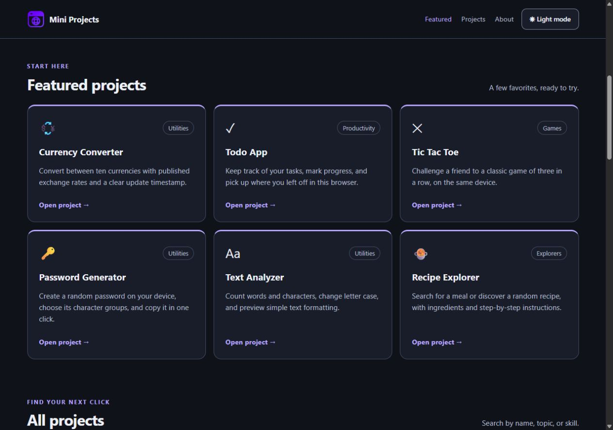

# Mini Projects

Small apps, thoughtful details. A collection of browser tools and games built with **HTML, CSS, and vanilla JavaScript** by Felipe Vanegas Gil.

The homepage highlights **six featured projects**. The apps share responsive layouts, light and dark themes, and keyboard-friendly controls. There is no framework, package installation, or build step.



- **Demo App:** [https://mini-projects-gold.vercel.app/](https://mini-projects-gold.vercel.app/)

## Explore the collection

Open the homepage using a local web server, then:

1. Choose a **Featured project**, or browse **All projects**.
2. Search by name, description, category, or tag. Category filters and search work together; featured projects remain visible independently.
3. Open a card to use the app. Select **All projects** in its navigation to return to the collection.
4. Use the theme button to switch between light and dark mode. Your preference is remembered when browser storage is available; otherwise the site starts with your system preference.

| Project               | What it does                                                                                               | Source and guide                                         |
| --------------------- | ---------------------------------------------------------------------------------------------------------- | -------------------------------------------------------- |
| Avatar Generator      | Turn a nickname into a repeatable illustrated avatar, with three styles to explore.                        | [Avatar Generator](projects/avatar-generator/)           |
| Calculator            | Work through everyday calculations with decimals, parentheses, and keyboard support.                      | [Calculator](projects/calculator/)                       |
| Country Explorer      | Search countries and territories by name or country code, and explore capitals, languages, and currencies. | [Country Explorer](projects/country-explorer/)           |
| Currency Converter    | Convert between ten currencies with published exchange rates and a clear update timestamp.                 | [Currency Converter](projects/currency-converter/)       |
| Emoji Catcher         | Catch as many smiling faces as you can in a 30-second round.                                               | [Emoji Catcher](projects/emoji-catcher/)                 |
| Form Validation Demo  | Explore inline form validation and password requirements without creating an account.                      | [Form Validation Demo](projects/form-validation-demo/)   |
| GitHub Profile Finder | Explore a public GitHub profile and its six most recently updated repositories.                            | [GitHub Profile Finder](projects/github-profile-finder/) |
| Kanban Board          | Organize tasks into To do, In progress, and Done using drag and drop or simple move controls.              | [Kanban Board](projects/kanban-board/)                   |
| Password Generator    | Create a random password on your device, choose its character groups, and copy it in one click.            | [Password Generator](projects/password-generator/)       |
| Pokémon Explorer      | Look up a Pokémon by name or number, or meet a random member of the original 151.                          | [Pokémon Explorer](projects/pokemon-explorer/)           |
| QR Code Generator     | Create a QR code for short text or a URL entirely on your device.                                          | [QR Code Generator](projects/qr-code-generator/)         |
| Reaction Time Game    | Wait for the target, then select it as quickly as you can.                                                 | [Reaction Time Game](projects/reaction-time-game/)       |
| Recipe Explorer       | Search for a meal or discover a random recipe, with ingredients and step-by-step instructions.             | [Recipe Explorer](projects/recipe-explorer/)             |
| Stopwatch             | Measure elapsed time, pause and resume, and record laps.                                                   | [Stopwatch](projects/stopwatch/)                         |
| Text Analyzer         | Count words and characters, change letter case, and preview simple text formatting.                        | [Text Analyzer](projects/text-analyzer/)                 |
| Tic Tac Toe           | Challenge a friend to a classic game of three in a row, on the same device.                                | [Tic Tac Toe](projects/tic-tac-toe/)                     |
| Todo App              | Keep track of your tasks, mark progress, and pick up where you left off in this browser.                   | [Todo App](projects/todo-app/)                           |

## Run locally

Download or clone this repository and open its root folder in your terminal. If Node.js is already available, the included preview server uses only its built-in modules:

```sh
node scripts/serve.mjs
```

Open [http://127.0.0.1:4173](http://127.0.0.1:4173). Stop the server with **Ctrl+C**.

An existing static web server also works: serve the repository root and open its homepage. Opening `index.html` directly with `file://` is unsupported because the site fetches its catalog and shared HTML, and the apps use JavaScript modules. No `npm install` command is required.

The preview script binds only to your computer. It is a development convenience, not a production server. Hosting the collection requires only a static host with HTTPS; no server-side application is needed.

## Repository structure

```text
index.html, style.css, script.js   Homepage
projects.json                    Project catalog
assets/                          Site logo and favicon
shared/                          Theme, navigation, footer, CSS, storage and optional UI helpers
projects/<id>/                   Independent apps and their documentation
docs/                            Third-party credits and licenses
scripts/                         Optional preview server and source checks
tests/                           Core behavior tests
```

Shared styles define theme colors, typography, layout, and common controls. Each app scopes its own styles beneath a project wrapper. Project scripts are browser modules, so their variables do not collide with other scripts.

## Checks

With Node.js already available:

```sh
node scripts/check.mjs
node --test tests/*.test.mjs
```

The source check verifies catalog entries, required project files, local references and capitalization, module imports, duplicate HTML IDs, CSS variables, and JavaScript syntax. Tests cover task identity, game outcomes, password constraints, text analysis, recipe ingredients, country search, QR input limits, timing, API response handling, and theme color contrast.

With the preview server running, open [the browser checks](http://127.0.0.1:4173/tests/browser.html) to exercise blocked storage, corrupt saved data, network errors, late responses, catalog retry, and clipboard denial against the real app pages. These checks cover the original apps and the migrated tools, games, and explorers. They use isolated in-memory storage and mock API responses; they do not change your saved tasks or clipboard. Visual behavior and keyboard interactions should also be checked manually.

## Data, privacy, and dependencies

- **Local storage:** theme, Todo tasks, Kanban cards, and currency preferences stay in this browser. There is no account or cross-device sync. Storage failures do not prevent basic use.
- **Local tools and games:** calculations, text, practice form values, passwords, QR contents, scores, and stopwatch laps are processed on-device. They are not saved by those apps. Copy buttons write to the clipboard only when selected; HTTPS or localhost is required.
- **Country Explorer:** searches a bundled reference dataset locally. It does not send queries to a country API.
- **Online explorers:** currency rates, recipes, GitHub profiles, Pokémon, and avatars use third-party services. Submitted search terms or avatar seeds are sent to the relevant provider; providers also receive ordinary network request information. Do not enter sensitive information into public searches.
- **Currency Converter:** published exchange rates exclude fees and are not a live trading feed.
- **Password tools:** the generator uses cryptographic randomness. Strength labels and the validation demo's character requirements are educational estimates, not guarantees.

| App                   | External service                                                     |
| --------------------- | -------------------------------------------------------------------- |
| Currency Converter    | [ExchangeRate-API](https://www.exchangerate-api.com/)                |
| Recipe Explorer       | [TheMealDB](https://www.themealdb.com/api.php), educational test key |
| GitHub Profile Finder | [GitHub REST API](https://docs.github.com/en/rest), unauthenticated  |
| Pokémon Explorer      | [PokéAPI](https://pokeapi.co/)                                       |
| Avatar Generator      | [DiceBear](https://www.dicebear.com/)                                |

Online apps require internet access. Service outages, rate limits, and image failures are reported on the page. Search requests time out and superseded results are discarded.

No external fonts, CSS frameworks, analytics, or tracking scripts are included. QR Code Generator uses the existing **QRCode.js 1.0.0** dependency, bundled locally with its MIT license. No package manager or installation is needed. Country Explorer includes a separately licensed **ODbL 1.0** dataset.

See [credits and licenses](docs/credits.md) for third-party code, data, artwork, and provider attribution.

## Storage and request reliability

Todo and Kanban serialize read-modify-write operations with Web Locks and read the latest saved collection inside each lock. Storage events synchronize other tabs. If locks or storage are unavailable, edits remain temporary in memory and the page explains that they are not saved. No unlocked whole-list write can overwrite another tab. Catalog and shared navigation/footer requests have a twelve-second deadline so loading can recover from a stalled request. Browser checks include simultaneous add/delete operations in two isolated frames.

## License

This project is licensed under the [MIT License](LICENSE). Third-party dependencies, bundled assets, and data retain their respective licenses and terms.
